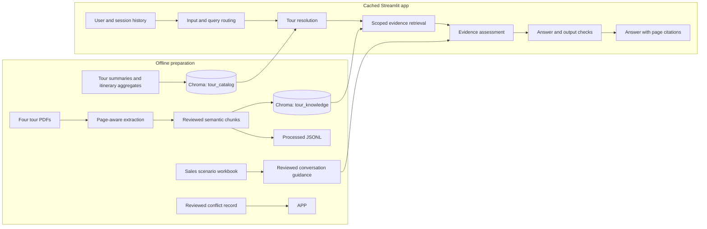

# Vietravel Tour Assistant

A Vietnamese, citation-grounded chat demo for four Vietravel tour PDFs. It answers itinerary, price, inclusion, baggage, payment, cancellation, and visa-document questions from the supplied tour material, and escalates ambiguity, source conflicts, current availability, and higher-risk requests. It does not book or change a reservation.

## Architecture



The app uses DeepSeek Flash for query understanding, evidence assessment, and answer generation, Gemini Embedding 001 for embeddings, LangGraph for request flow and session continuity, Chroma for retrieval, and Streamlit for the chat UI. A factual answer must be grounded in retrieved tour PDF evidence and its citations identify the tour, section, and PDF page.

## Sources and indexing

Source authority is deliberately separated:

- The four tour PDFs are the only factual authority for prices, schedules, inclusions, baggage, and policies.
- The sales workbook supplies tone and conversation guidance only. It is not factual evidence.
- The assignment document is not indexed.

PDF extraction preserves page provenance. Chunk boundaries follow section and meaning: each itinerary day is separate, price tables and footnotes stay together, child-price bands remain complete, and payment and cancellation conditions stay with their fees. Repeated policies remain attached to each tour. The known Đà Nẵng baggage disagreement is retained as two claims and routed to staff confirmation.

The reviewed files in `data/processed/` are the deployment inputs:

- `tour_chunks.jsonl`: 84 knowledge chunks from four PDFs.
- `tour_catalog.jsonl`: 8 records, one tour summary and one full-itinerary aggregate per tour.
- `sales_guidance.json`: 20 conversation scenarios, excluded from factual retrieval.
- `conflicts.json` and `chunking_report.json`: the curated baggage conflict and ingestion review record.

`chroma_db/` is local generated state and is not committed. On the first cached app initialization, the app compares collection counts with the processed JSONL and builds or repairs the two application-owned collections from those files. It does not extract PDFs on a user request. Streamlit's `st.cache_resource` keeps that initialization shared for sessions in the running app process. A Cloud restart may rebuild the index and make Gemini embedding calls again.

## Run locally

Use Python 3.11 or newer. From the repository root:

```bash
python3 -m venv .venv
source .venv/bin/activate
python -m pip install --upgrade pip
python -m pip install -e ".[dev]"
cp .env.example .env
```

Add your own provider credentials to the ignored `.env` file. The required setting names are `DEEPSEEK_API_KEY` and `GEMINI_API_KEY`. Optional settings are `DEEPSEEK_BASE_URL`, `LLM_MODEL`, `EMBEDDING_MODEL`, `EMBEDDING_OUTPUT_DIMENSIONALITY`, and `CHROMA_PERSIST_DIR`. Defaults are declared in `src/vietravel_rag/config.py`; do not commit `.env`.

To reproduce reviewed artifacts and build the local Chroma index from the four PDFs and sales workbook:

```bash
python scripts/ingest.py --build-artifacts --build-index
```

This command reads files under `raw_data/` and `reference/`, which are local source inputs and are intentionally not included in this repository. The processed JSONL files are enough to run or deploy the app; PDF extraction is only needed to regenerate them.

Start the chat app:

```bash
streamlit run app.py
```

To revalidate the reviewed corpus without calling model APIs:

```bash
python scripts/audit_chunks.py
```

## Evaluation

The committed report is `results/eval_summary.json`, produced on 2026-10-23. The full evaluation calls the configured chat and embedding APIs and can incur charges. It requires the DeepSeek price assumptions and their source to be recorded explicitly:

```bash
python scripts/evaluate.py \
  --input-price-per-million 0.3 \
  --output-price-per-million 1.2 \
  --price-source-url https://api-docs.deepseek.com/quick_start/pricing/
```

Use `--limit 1 --skip-ragas` for a smaller deterministic smoke run. Do not run a full evaluation when the account balance is insufficient. The recorded prices are DeepSeek Flash cache-miss input and output rates used for this run; Gemini embedding charges are not included in the token-cost estimate.

### Recorded results

The dataset contains 30 cases. The graph completed 29; `multiturn_compare_followup` failed with `OutputParserException`. Deterministic scores use 30 as the requested-case denominator:

| Metric | Result |
|---|---:|
| Intent accuracy | 0.867 |
| Tour-resolution exact match | 0.900 |
| Answer-status accuracy | 0.767 |
| Clarification, conflict, and refusal accuracy | 0.750 |
| Citation validity | 1.000 |
| Numeric grounding rate | 1.000 |
| Forbidden-claim rate | 0.000 |
| Latency p50 / p95 | 7.41 s / 15.10 s |

Citation validity is conditional on a citation being emitted: it checks whether each emitted citation ID was retrieved. It does not measure whether an answer that should cite a source emitted one, so it is not citation coverage or completeness.

Ragas 0.3.1 results were partial because DeepSeek returned insufficient-balance errors during judging. Means below use only finite scores; missing values remain missing. The judge was also DeepSeek, the same model family used to generate answers, so these are not independent quality judgments.

| Ragas metric | Finite cases | Mean |
|---|---:|---:|
| Context precision with reference | 21/30 | 0.508 |
| Context recall | 22/30 | 0.727 |
| Faithfulness | 21/30 | 0.726 |
| Answer relevancy | 22/30 | 0.539 |
| Answer correctness | 17/30 | 0.346 |

The run recorded $0.4623 in DeepSeek usage and projected $15.4105 per 1,000 attempted cases at the supplied rates. This includes the completed Ragas judge calls and excludes Gemini embedding usage. The low answer-status and clarification/conflict/refusal scores, one parser failure, and missing Ragas judgments are material limitations; the scores should guide further review, not be read as production acceptance.

## Five-prompt interview demo

Start a fresh chat for prompt 3 so it has no selected tour. Use the prompts in order otherwise; prompt 2 is a follow-up to prompt 1.

1. `Giá tour Bangkok – Pattaya bao nhiêu?` — factual price with a PDF citation.
2. `Bé 8 tuổi thì sao?` — follow-up that should inherit the Bangkok–Pattaya context.
3. `Lịch trình tour đó gồm những điểm nào?` — ambiguous without an active tour; ask which tour.
4. `Hành lý ký gửi của tour Đà Nẵng quy định ra sao?` — show both conflicting source claims and citations, then recommend confirmation.
5. `Tour Bangkok – Pattaya hôm nay còn chỗ không?` — explain that live availability cannot be confirmed and direct the customer to staff.

Answers show status and source expanders. The debug view is restricted to retrieved chunks and an allowlist of citation metadata.

## Streamlit Community Cloud

The app is prepared for Community Cloud, but deployment requires this repository to be published to GitHub and connected to a Cloud workspace. The current checkout has no configured Git remote, so no deployment URL exists yet.

1. Publish the reviewed repository and processed artifacts to a GitHub repository. Do not publish `.env`, `.streamlit/secrets.toml`, source PDFs, or the generated Chroma database.
2. In [Streamlit Community Cloud](https://share.streamlit.io/), choose **Create app**, connect the GitHub repository and branch, and set `app.py` as the app file. Select the same Python version used locally.
3. Open **Advanced settings → Secrets** and enter the TOML keys shown in `.streamlit/secrets.toml.example`, replacing the empty values with credentials in the Cloud settings form. The app reads these through `st.secrets`; the example itself contains no credentials.
4. Deploy and wait for initialization. The first start creates Chroma from the reviewed JSONL using Gemini embeddings; this may consume API quota and will repeat if the app restarts without a retained local index.
5. Run the five-prompt interview demo against the deployed app and inspect citations and the source expander.

See Streamlit's current guides for [deploying an app](https://docs.streamlit.io/deploy/streamlit-community-cloud/deploy-your-app) and [managing secrets](https://docs.streamlit.io/deploy/streamlit-community-cloud/deploy-your-app/secrets-management). Hosting is free under Community Cloud's terms; inference and embedding APIs are separate services and may incur costs.

## Limits

- No live seat availability, current promotions, booking, payment, cancellation, CRM, or passport collection. Staff must confirm current status and perform any transaction.
- Conversation history is held in Streamlit session state and an in-memory graph checkpointer; it is not durable across restarts.
- The conflict list is curated for known source disagreements and does not automatically discover every contradiction.
- The app only knows the four supplied tour PDFs. It does not browse Vietravel's site or update stale source material.
- DeepSeek judges its own generation family in the recorded Ragas run; this can bias evaluation. Several metric values are absent due to insufficient judge balance.
- Free hosting does not make the provider API calls free. First startup can embed the corpus, and each question can use chat-model tokens.
- No Community Cloud deployment or deployed five-scenario acceptance has occurred because the repository has no remote or published GitHub source.
